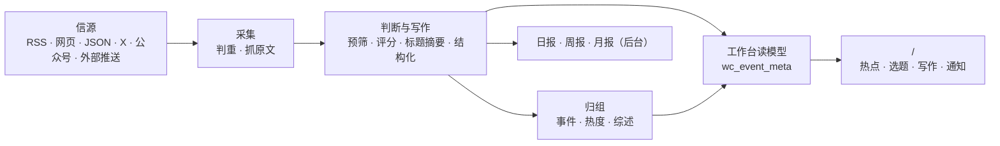

# 架构



公开阅读站已按 WCH-33 下线：网页、RSS、API v1、MCP、llms.txt、站点地图和分享图都不再提供。`/` 就是工作台首页，唯一使用者是管理员。

## 三个进程

| 进程 | 位置 | 做什么 |
|---|---|---|
| api | `apps/api/` | Fastify。工作台接口（`/api/studio/`）、后台接口（`/api/admin/`）、收录推送（带 token）和健康检查 |
| worker | `apps/worker/` | pg-boss 任务队列和定时任务：抓信源、调模型、归组、热度、日报、告警、清理 |
| web | `apps/web/` | React Router 服务端渲染的网页。只通过 HTTP 读 api，不碰数据库 |

业务代码都在 `packages/backend/`，前后端共用的类型和常量在 `packages/contracts/`。这个站自己的名字、文案、品牌和页面在 `site/`，行业的分类、信源、提示词和门槛在 `industry/`，只属于这个站的功能在 `modules/`（见下文“模块”）。

## 几条不变的规则

- **只有工作台和后台对外**：公开阅读站已经下线，工作台根路径、后台 `/admin/*` 之外没有页面；`wc_` 私有数据只通过管理员会话读取。
- **事件读模型是工作台的唯一入口**：热点、详情、选题和写作都读 `wc_event_meta`；公开读取层不再参与工作台查询。
- **页面不调模型**：读者打开页面只读数据库里已经有的结果；模型只在 worker 的任务里调用。
- **花钱的请求有回执**：每个付费请求（模型、X、公众号、Jina）先记一张回执，拿到结果先存再用。进程重启、任务重试时，复用已经付过钱的结果，不重复花钱（`providers/receipts.ts`）。结果不明的回执超过 30 分钟后自动放行一次；因它停在失败状态的文章会重新入队，继续未完成的正文提取或分析。再次结果不明时，由管理员在“运行”页核对后放行。
- **预算熔断**：每个付费服务有每分钟、每小时、每天的上限，超过就暂停（后台“设置 → 付费请求上限”）。
- **安全阀**：`COLLECT_ENABLED`、`MODEL_CALLS_ENABLED`、`FEISHU_CONTENT_PUSH_ENABLED`、`FEISHU_INTERNAL_ENABLED`、`INDEXNOW_SUBMIT_ENABLED` 只决定“发不发出去”，不决定走哪套逻辑；只有设成 `true` 才打开，没写就是关。`scripts/init-env.ts` 生成的 `.env` 会打开采集和模型调用，只调界面时可以改成 `false`；测试里推送一直关着，采集和模型调用只连本地假服务。
- **单用户**：管理员会话就是唯一使用者，不设计注册、团队和权限。
- **旧文不刷屏**：发现时已发布超过 48 小时的资料、新信源第一次导入的存量、回灌的推送，按原文时间归档，不进“今天”、不推送；第一次导入之后不再收列表里更早的存量。没有可信发布时间的资料先不公开，读到日期后再判断新旧。
- **来源可追溯**：每条精选都链接原文；站内是否显示全文由信源的 `site_fulltext` 决定，默认只显示摘要。
- **规则由所属模块维护**：后台调用内容、事件、通知与恢复模块，不直接改写它们的状态；业务模块不反过来依赖后台。人工修改、公开结果与恢复所需记录一起提交。
- **跨进程接口共享类型**：后台接口以 `packages/contracts/src/admin.ts` 为准，任务载荷以 `jobs/queue.ts` 的 `JobData` 为准，发送方和接收方一起检查。前端仍只通过 HTTP 访问后端。

这些模块边界由 `tests/architecture.test.ts` 检查；调整边界时同时更新约定与检查。站点身份和每一步的模型从 `site/` 读，行业分类和提示词从 `industry/` 读，代码里不写死某个站的值。

## 目录

| 位置 | 内容 |
|---|---|
| `site/` | 这个站自己的：站名文案、每一步的模型、品牌与 Logo，以及启用哪些模块（`site/modules/`） |
| `industry/` | 行业包：分类标签、主题、示范信源、提示词、门槛 |
| `modules/` | 只属于这个站的功能，一个功能一个文件夹（见下文“模块”）；框架本身不带模块 |
| `packages/backend/src/sources/` | 六种信源的读取器，抓取调度（`collect.ts`） |
| `packages/backend/src/content/` | 资料入库、判重、正文提取和清洗 |
| `packages/backend/src/editorial/` | 判断与写作：`analyze.ts`（流程）、`prompts.ts`（读提示词）、`models.ts`（每一步用哪个模型） |
| `packages/backend/src/events/` | 事件归组、热度、事件综述 |
| `packages/backend/src/publication/` | 出刊与工作台仍复用的读取工具（公开出口已下线，逐步收敛） |
| `packages/backend/src/reports/` | 日报、周报、月报 |
| `packages/backend/src/providers/` | 模型、向量、X、公众号、Jina 的调用，回执与预算 |
| `packages/backend/src/notify/` | 飞书推送 |
| `packages/backend/src/operations/` | 告警、备份、清理 |
| `packages/backend/src/admin/` | 后台接口 |
| `apps/web/app/routes/` | 每个页面一个文件，路由表在 `apps/web/app/routes.ts` |
| `database/migrations/` | 数据库迁移，按完整文件名排序执行和记账 |
| `scripts/` | 初始化、迁移、种子数据、评测、检查脚本 |
| `tests/` | 后端测试（数据库名必须以 `_test` 或 `_ci` 结尾，见下文） |

## 模块

框架里没有、只有你这个站要的功能（比如一个专门的榜单或监控页），做成模块：一个功能一个文件夹 `modules/<名字>/`，是一个名为 `@aihot/<名字>` 的 npm 包，装着它自己的后端、接口、页面、样式、数据库迁移和测试。

| 文件 | 内容 |
|---|---|
| `module.ts` | 它的地址：页面、跳转、交给 api 处理的路径（类型见 `packages/contracts/src/modules.ts`） |
| `server.ts` | 它接进后端的插口：接口、定时任务、队列、事件回调、后台页面的数据等（`packages/backend/src/modules.ts`，每个插口注明读它的文件） |
| `web.tsx` | 它接进网页的插口：页面、导航项、主题页与后台的部件等（`apps/web/app/modules.ts`）；只在某一页出现的部件给出加载函数，随那一页的代码加载 |
| `migrations/` | 它自己的表，和 `database/migrations/` 一起按文件名排序执行 |
| `tests/` | 它的测试，`npm test` 一起跑 |
| 其他文件 | 它自己的图片等静态文件也放在模块文件夹里，在 `server.ts` 的 `http` 插口里注册路由发出（类型、ETag、缓存头和 404 自己处理） |

写好以后在 `site/modules/` 的三份清单里列上它：`index.ts` 列地址，`server.ts` 列后端，`web.ts` 列网页，没有的那份不列；再在 `site/package.json` 的 `dependencies` 里写上它。用 Docker 部署的，在 `Dockerfile` 里照着其他包加一行 `COPY modules/<名字>/package.json modules/<名字>/`。框架的代码不导入任何模块，只读这三份清单，所以合并本仓库以后的更新时，不容易和你自己的功能冲突。插口不够用时，在框架里加一个通用的插口，而不是把这个功能写进框架。

## 数据库迁移

已经发布的迁移是部署历史，不能改写或删除；修正放进新的文件。引擎和模块的迁移遵循同一套约定：按完整文件名排序执行，并以完整文件名记录是否已经执行；编号相同的不同文件分别执行，同一完整文件名不能出现在两个目录中。从 `0055` 起，每个文件只放一条允许在线执行的语句，PR 会拒绝不符合约定的新增迁移，也不允许用较小编号绕过检查。这样避免前一条语句锁住表后，又在同一事务里等待别的表或扫描大量数据。

新增列优先使用可空列或常量默认值；给已有表加 CHECK、外键时先 `NOT VALID`，再用另一个迁移验证。索引使用单独的 `CREATE INDEX CONCURRENTLY IF NOT EXISTS`；不能在发布迁移里做大批 UPDATE、DELETE 或用 DO 隐藏它们。数据回填需另做分批、可观测的操作，并先在备份副本上验证。

多个筛选条件存在相关性、查询计划因此严重低估行数时，可以为这些列创建 MCV 联合统计，再用单独的迁移 `ANALYZE` 指定表的这些列。先用真实分布验证收益；不增加没有依据的统计对象，也不在迁移里做全库分析或跳过被锁住的表后假定成功。

改类型、删列等破坏性变更需要单独设计升级与回退步骤，在 [部署文档](deploy.md#更新) 说明对已有数据的影响；当前在线迁移检查不会直接放行。代码已不再使用的表，确认可以删掉它的数据后，单独一个迁移文件写 `DROP TABLE IF EXISTS <表>`（不带 CASCADE，仍有对象依赖它时迁移失败），同样在部署文档里写明。需要扩展允许的语句时，先证明它不会长期阻塞正在服务的请求，并补齐相应检查，不能关闭检查或修改旧账本。

## 入口

公开站点已下线，保留下来的只有工作台、后台和健康检查。

| 地址 | 内容 |
|---|---|
| `/` | 工作台首页（热点发现） |
| `/`、`/events/*`、`/topics/*`、`/articles/*`、`/sources/*`、`/brands/*`、`/alerts`、`/calendar`、`/settings` | 工作台 |
| `/studio/*` | 旧地址 302 到对应根路径 |
| `/admin`、`/admin/*` | 后台：内容、信源、运行、模型、审计 |
| `/api/health` | 健康检查（数据库连通性） |

已下线的出口：`/all`、`/hot`、`/daily`、`/topics`、`/starred`、`/about`、`/changelog`、`/feedback`、`/more`、`/agent`，RSS（`/feed.xml` 等），公开 API（`/api/v1/*`、`/openapi-v1.json`、`/api/site/*`），MCP（`/api/mcp`），`/llms.txt`、`/sitemap.xml`、`/robots.txt`、`/manifest.webmanifest`、分享图与图标。`scripts/smoke.ts` 会确认它们都返回 404。

## 测试

```bash
npm run typecheck
DATABASE_URL=postgres://127.0.0.1:5432/myhot_test npm test
npm run build -w @aihot/web && node --test apps/web/tests/*.test.ts
```

`DATABASE_URL` 指向的库名必须以 `_test` 或 `_ci` 结尾；没有会自动创建并迁移。每个测试文件在它的一份副本上并行运行，所以数据库账号要有建库权限（`CREATEDB`）。测试不访问任何外部服务：模型和付费接口都由本地假服务回答。
